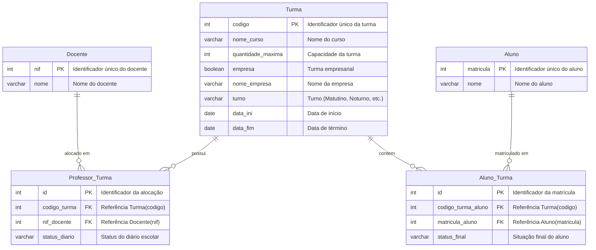

# Sistema de Gestão Escolar - Banco de Dados Vercel Postgres

Esquema de banco de dados relacional SQL desenvolvido especificamente para o ambiente de banco de dados da **Vercel** (**Vercel Postgres / Neon**).

---

## 📊 Estrutura e Relacionamentos

O sistema gerencia turmas escolares, alunos e docentes, estabelecendo os relacionamentos N:N através de tabelas associativas:

---

## 🔑 Tipagem dos Identificadores

Conforme especificado, todos os campos identificadores foram padronizados como **números inteiros (`INT`)**:

| Tabela | Identificador | Tipo SQL | Descrição |
| :--- | :--- | :--- | :--- |
| **Docente** | `nif` | `INT PRIMARY KEY` | Chave primária do professor |
| **Aluno** | `matricula` | `INT PRIMARY KEY` | Chave primária do aluno |
| **Turma** | `codigo` | `INT PRIMARY KEY` | Chave primária da turma |
| **Professor_Turma** | `id` | `INT GENERATED ALWAYS AS IDENTITY PRIMARY KEY` | Identificador único numérico |
| **Aluno_Turma** | `id` | `INT GENERATED ALWAYS AS IDENTITY PRIMARY KEY` | Identificador único numérico |

---

## 🚀 Como executar no ambiente Vercel (Vercel Postgres)

No painel da Vercel, o gerenciamento de banco SQL é feito através da ferramenta **Vercel Postgres**:

1. Acesse o seu painel na **[Vercel](https://vercel.com)**.
2. Acesse o projeto **`nutriteste`** ou vá na aba global **Storage**.
3. Caso ainda não tenha criado o banco, clique em **Create Database** e selecione **Postgres (Neon)**.
4. Clique no seu banco de dados Postgres e selecione a aba **Query** (Console SQL interativo).
5. Copie e cole o conteúdo do arquivo [`schema.sql`](./schema.sql) no editor e clique em **Run Query**.
6. *(Opcional)* Execute também o conteúdo do arquivo [`seed.sql`](./seed.sql) para inserir dados de teste e [`queries_exemplo.sql`](./queries_exemplo.sql) para testar os relatórios e joins.

---

## 📁 Arquivos do Projeto

- [`schema.sql`](./schema.sql): Script DDL de criação das tabelas, chaves primárias, chaves estrangeiras, restrições e índices.
- [`seed.sql`](./seed.sql): Dados de exemplo para popular as tabelas e testar a integridade referencial.
- [`queries_exemplo.sql`](./queries_exemplo.sql): Consultas de exemplo com `INNER JOIN` e `LEFT JOIN` unindo as tabelas relacionadas.
